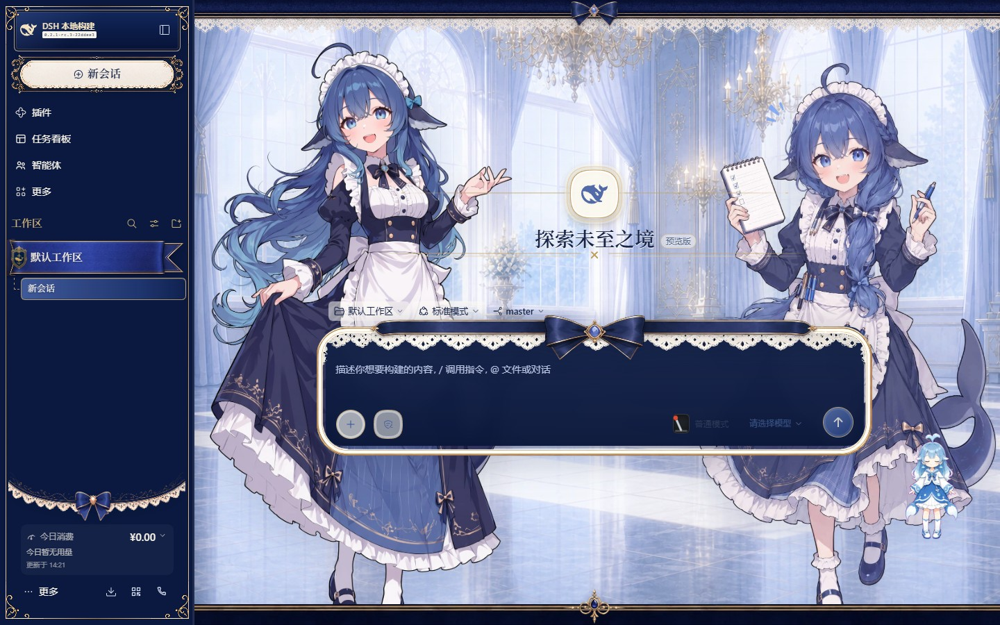
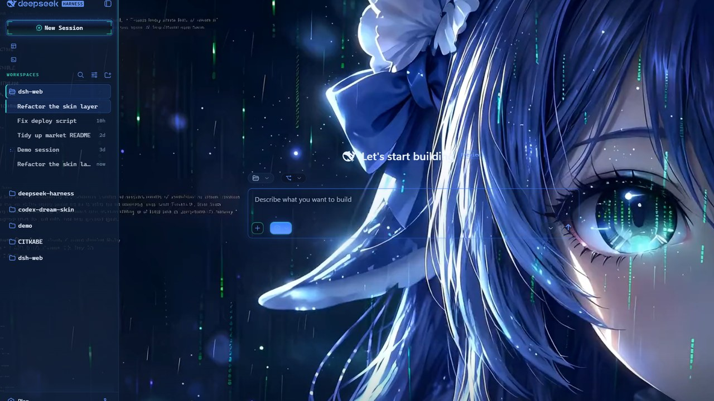

# dsh-skins · DeepSeek Harness (DSH) 皮肤中心

[English](README.md) | 中文

<p align="center">
  
  &nbsp;
  
  &nbsp;
  
</p>

<p align="center">
  <strong>DeepSeek Harness（DSH）官方 Web GUI 与桌面客户端专属主题与个性化美化引擎</strong><br>
  <em>主题换肤 · 毛玻璃高斯模糊 · 自定义深浅色配色 · 创意工坊即时试穿 · Wallpaper Engine 由专用插件提供</em>
</p>

`@linxin666/dsh-client-ui-skin-center`（cordis 插件 id `ui-skin-center`）是 dsh Web GUI 唯一的皮肤包：它把皮肤列表 / 试穿 / 应用放进「设置 → Web 扩展 → 皮肤」TAB（父级缺席时保留一级「皮肤中心」分区，只列已安装皮肤），并且是所有皮肤的唯一加载器与渲染器。皮肤是纯资产目录——没有 package.json、不发 npm、不接 cordis 接线——只与皮肤中心契约（`contracts/`）耦合；皮肤中心把对官方 DSH 的全部耦合吸收在契约之后。卡片自带总开关（关闭即停用试穿、应用与背景控制）。

- 列表：展示「官方默认」加目录册里已安装的皮肤（名称、标语、强调色），当前应用目标带「使用中」标记。目录册合并两个来源：随本包内置的默认皮肤（`skins/blue-fantasy/`）与放进 `$DSH_HOME/skins/<id>/` 的用户皮肤（同 id 时用户皮肤遮蔽内置皮肤）。皮肤集中的其余皮肤都是市场条目：在 DSH 市场商店一键按需安装到 `$DSH_HOME/skins/<id>/`，即由同一目录册作为用户皮肤管理——无需重启，重开卡片或刷新页面即收录。`skin.json` 校验失败的皮肤按 fail-closed 排除，并作为目录诊断上报。
- 自定义主题：列表末尾提供一张基于官方默认外观派生的用户级主题卡，与「官方默认」及目录册皮肤相互独立。浅色、深色分别编辑强调色、背景色、前景色和对比度（0–100），支持即时试穿、应用、恢复当前模式默认值和刷新持久化。生成的 CSS 只能覆盖经审计的官方 token 白名单，不接收选择器、任意 CSS 或资源 URL；不会修改任何第三方皮肤定义，目录册皮肤激活时自定义主题层自动停用。
- 试穿 / 应用：两者走同一个原子切换引擎（`src/client/runtime/skin-controller.ts`）。一次切换 = 一个新的 activation identity：取回已限定作用域的样式表，安装样式、背景媒体与可选 hooks，翻转 `html[data-dsh-skin="<id>"]`，然后销毁上一个 activation（append-only 效果账本，幂等清理）。最新请求永远胜出；失败或被淘汰的切换完整保留旧皮肤。试穿是同一个切换但不落盘——「退出试穿」恢复已提交的皮肤。应用会持久化选择（`POST /api/skin-center/v2/active`）。不刷新页面、不改写 `cordis.patch.yml`、不重建启动图。
- 首屏：host 半区注册一个 index.html 转换（`webServer.tapIndex`，单一适配模块 `src/tap-index-adapter.ts`），向每份送达的文档盖 `html[data-dsh-skin]` 属性并插入样式表链接，刷新后直接以当前皮肤启动，无官方原貌闪屏。tap 出任何问题都 fail-closed 回官方原貌。
- 皮肤格式（v2）：`skin.json`（fail-closed 校验，v1 字段 `package`/`wiring`/`bodyAttr` 忽略并给迁移警告）、`skin.css`（L1 token 重映射 + L2 语义选择器）、可选 `patches.css`（L3 自由选择器，高敏感）、可选 `hooks.mjs`（受信逃逸舱，高敏感）、`assets/`、`preview/`。所有 CSS 经过安全管线：每个选择器强制限定在 `html[data-dsh-skin]` 下，`@import` / 远程或协议相对 URL / 越界路径直接报错。宿主半区自身从不加载 CSS 解析器——每次转换都在一个短生命周期 worker 进程（`src/core/css-safety/host-transform.ts` + `worker-entry.ts`）中执行：每个请求单独 fork 一个 worker，并在样式表响应写回之前确认 worker 已退出，因此宿主进程从不映射解析器的原生 addon。见 `contracts/README.md`。
- 覆盖契约：L1 重映射官方 `--dsw-*` 设计 token；L2 样式语义属性（`data-dsh-surface` / `data-dsh-part` / `data-dsh-plugin`，枚举见 `contracts/semantic-attrs-v1.md`），由兼容适配器（`src/client/runtime/semantic-adapter.ts`）从稳定锚点（`data-slot` 出口、`data-chat-flow-kind` 等）为官方壳层 DOM 打标；L3 补丁任意选择器，脆弱性由皮肤作者自负。主动输出语义属性的插件获得完整 L2 覆盖；不输出的只享受 L1。目录皮肤或自定义主题激活期间还会启用公共壳层渲染适配器：它清除工作区列表末端 fade，将 composer 占位符固定为不透明的主题次级文本色，并为会话滚动口保留底部安全间距以保证吸底正文不被输入区覆盖（#978），各皮肤无需重复补丁。
- 背景优先级：壁纸渲染期间皮肤及其背景媒体整体停画（见「Wallpaper Engine」），背景完全归壁纸；否则皮肤清单背景媒体即背景。
- 背景控制：背景遮蔽滑杆（0–100%）为画背景的皮肤在面板后加纱，两个按状态的高斯模糊滑杆（0–20 px）分别控制空对话与有内容时的背景，输入卡模糊滑杆（0–20 px）只控制输入卡背后的磨砂区域，气泡不透明度滑杆（0–100%）控制支持气泡 alpha 的皮肤消息气泡。整张壁纸模糊仍是独立的壁纸设置。背景模糊通过外壳之后的固定 `backdrop-filter` 元素施加；0 完全关闭（无元素、无 GPU 开销）。输入卡磨砂由独立的 body 级固定跟随层（`data-dsh-composer-frost` 元素）承担并按输入卡尺寸跟随，**不**挂在卡片本体上：卡片一旦带 `backdrop-filter` 就会成为其中 shell fixed tooltip 的包含块，悬停时整页会话会被顶动。
- 旧版迁移：v2 升级后的首次启动，一次性桥（`src/legacy-bridge.ts`）读取 harness home 根 `cordis.patch.yml`（v1 CLI 写入处；活动 profile 的 `cordis.patch.yml` 作为次级位置也会探测）里已退役的 `dsh-skin` 受管段，把活动皮肤 id 迁进 v2 选择存储，并清除旧行。迁移幂等且 fail-closed（出错时旧状态原样保留）。仅在发生迁移、清理或失败时输出日志，无 legacy 状态的稳态保持静默（issue #788）。


## 核心特性与场景

| 核心使用场景 | 原生 DSH Web 局限 | 皮肤中心（dsh-skins）解决方案 |
|---|---|---|
| 个性化界面视觉与护眼暗色模式 | 仅支持单一官方默认黑白主题 | 内置经典 Blue Fantasy 蓝色幻想暗色主题，支持从创意工坊一键安装数十款精美主题 |
| Wallpaper Engine 动态壁纸交互背景 | 无法使用动态壁纸或视频背景 | 交给专用的 dsh-wallpaper-engine 插件（视频、Web 与 2D/3D WebGL 实时场景壁纸），本卡片负责安装指引并把背景让给它 |
| 毛玻璃背景模糊与输入卡磨砂控制 | 界面背景单一，无视觉层次感 | 提供全局背景遮罩（0–100%）、空会话/有内容动态高斯模糊、输入框局部磨砂跟随与气泡透明度滑杆 |
| 自定义品牌与个性配色重映射 | 无法自定义主题颜色与对比度 | 独立编辑浅色/深色强调色、背景色、前景色与对比度，自动生成审计级 CSS token 覆盖层 |
| 主题资产即时试穿与无感热切换 | 更换主题需重启服务或刷新页面 | 原子切换引擎实现一键即时试穿、退出恢复与持久化应用，刷新直接以当前皮肤启动零白屏闪烁 |

## 人气皮肤

[dsh-market.com](https://dsh-market.com) 创意工坊皮肤分类里人气最高的三款皮肤，按网站默认的「按人气」排序：

| 皮肤 | 作者 | 外观 |
|---|---|---|
| [深海女仆工坊](https://dsh-market.com/#skin:maid-atelier)（`maid-atelier`） | Small-tailqwq | 双女仆工坊背景、深海蓝蕾丝界面与 Q 版侧栏 |
| [鲸鱼娘 · 未至之境](https://dsh-market.com/#skin:whale-fantasy)（`whale-fantasy`） | stushansusu | 赛博数据雨少女特写背景 · 冷黑蓝全息 HUD · 电光蓝与青色高光 |
| [鲸吟](https://dsh-market.com/#skin:whale-song)（`whale-song`） | dsh-web | 深海鲸语女神背景 · 冰蓝海洋调色板 · 金色细线点缀 |

| 深海女仆工坊 | 鲸鱼娘 · 未至之境 | 鲸吟 |
|---|---|---|
|  |  |  |

三款都可从创意工坊一键安装。

## 安装

```sh
dsh plugin --profile web add @linxin666/dsh-client-ui-skin-center
# 仓库开发：dsh plugin --profile web add link:$(pwd)/packages/skins/skin-center
```

`$(pwd)` 是 dsh-web monorepo 的本地克隆。只有默认皮肤（蓝色幻想）随这个包发布；其余皮肤在 dsh-market.com 按需安装到 `$DSH_HOME/skins/<id>/`，社区皮肤同样是放进该目录的普通目录（均无安装命令、无需重启——重开卡片或刷新页面即收录）。新装默认激活蓝色幻想（宿主种子）；升级后原激活皮肤已不可用时回退官方主题。包内只发布 `skins/blue-fantasy`；其余皮肤保留在仓库 `skins/` 下，作为市场构建与画廊的目录来源，绝不进入 npm 包。

皮肤中心是符合官方 DSH 插件标准的自包含 bundle（`dsh.bundle.patch` 指向 `cordis.patch.yml`）；也可经 git 安装：`dsh plugin --profile web add github:<org>/dsh-web#<sha>`（`prepare` 脚本就地构建 `lib/`）。pnpm ≥10 安装 git 依赖前需授权 `allowBuilds`；本地 `link:` 安装无此要求。

## Wallpaper Engine

Wallpaper Engine 支持**不再内置**在本包。它由独立插件 [dsh-wallpaper-engine](https://github.com/elysia395/dsh-wallpaper-engine)（`dsh-plugin-wallpaper-engine`）提供，壁纸库、视频 / 网页 / 场景三条渲染路径、壁纸设置面与壁纸之上的玻璃都归它管。它是壁纸方面的**推荐**工坊条目，皮肤中心卡片可直接帮你装上。

**一键安装**：打开 设置 → Web 扩展 → 皮肤，在卡片的壁纸提示条上点「一键安装」。安装走宿主当前发布的插件管理面——存在官方进程内插件管理器时优先用它（与官方插件页同一个调用，也是打包版桌面客户端上唯一的写入者），否则退回家族插件管理器面；两者都没有时保留复制命令的兜底。

手工等价命令：

```sh
dsh plugin --profile web add dsh-plugin-wallpaper-engine
```

装完重启宿主（`dsh web`；DSH Desktop 需完全退出应用后重新打开）。该插件自带设置页用于选择与调节壁纸。

### 两者如何共处一页

两个插件轮流上阵而不是互相覆盖，切换是自动的：

- **壁纸渲染期间**，该插件给 `body` 打上稳定属性 `data-we-wallpaper`。皮肤中心读取该属性并**整体停掉自己的视觉工作**：不加载皮肤 CSS、不画皮肤背景图、不跑 hooks、不挂输入卡磨砂，并把 `html[data-dsh-skin]` 属性从页面上撤下。你在皮肤中心选的皮肤会被记住但不绘制——该插件改写了同一个壳层并画自己的玻璃，其他东西只会与它相争。
- **壁纸停止时**，属性清除，被记住的皮肤自动重新上妆，无需刷新、无需重新应用。
- **当你主动试穿或应用皮肤时**，这一次激活会先「抢一次台」：即使壁纸仍在渲染，皮肤也会上妆并翻上 `html[data-dsh-skin]`——该插件正是盯这个属性把舞台让回来的。对已穿戴的同一款再点一次「应用」同样算一次动作，因此每次应用都会写这个属性，而不是只在选择变化时才写。这个让路信号只发一次：若让路窗口内始终没有回应，皮肤会自行退回停画，等壁纸停止后再按记忆恢复。
- **首屏在被渲染之前，就先认下已记住的壁纸。** 上面那个属性是壁纸插件的客户端链在文档送达之后数百毫秒才写上的，而浏览器的首帧由送达的文档决定，等它到达时已经晚了。因此宿主在出页面时会同步读壁纸插件的持久化选择（`$DSH_WE_DATA_DIR/config.json`，缺省 `~/.dsh-wallpaper-engine/config.json`），里面选着壁纸时这一屏就完全不注入皮肤：不盖 `html[data-dsh-skin]`、不插皮肤样式表。被撤下的文档还会打一个标记，因此随后启动的界面也会先按住它的第一次激活——否则几百毫秒后那一次切换就会把这个空档重新填上。于是既有皮肤又有壁纸的页面刷新后直接开在壁纸上，没有一闪而过的皮肤要撤掉。皮肤仍然归你：若壁纸最终没能渲染，属性一撤掉、或这扇短窗关上（以先到者为准），运行时就会照旧把记住的皮肤应用回来。

停画期间卡片会写明原因，因此「皮肤不见了」读起来是一个状态而不是故障。你选中的皮肤任何时候都会落盘，壁纸没让它上场的部分也会在壁纸停止后自动生效。皮肤中心从不写该插件的状态，该插件也从不写皮肤中心的状态。

### 皮肤与壁纸

皮肤背景图属于皮肤自身外观的一部分，因此壁纸渲染期间会随皮肤整体停画。自带满幅底板的皮肤（目录里的 ground-plate 画布类）另把让路规则锚定在 `body[data-we-wallpaper]` 上，从而主动让位而不是争夺背景。

## 委托皮肤（由插件绘制的皮肤）

有些外观不是资产目录，而是各自作为插件发布的整套界面。Claude Code 风格就是其中一个：
它在 [dsh-claude-style](https://github.com/Nwflower/dsh-claude-style)（`dsh-claude-style`）里，
自行重绘外壳、侧栏、输入区与对话区。它是一个**独立包**：本仓库不捆绑、不接管版本，也不
分发它的文件。

这样的外观同样是**可以选用的皮肤**。它在页面顶部「插件提供的外观」分组里独占一张卡片，与
Wallpaper Engine 卡片并排，带 `插件皮肤` 标记；皮肤中心开启时，用起来与其他皮肤完全一致：试穿、
应用，刷新后依然保留。它不占网格里的方块位：那一格是为了放预览图，而这套外观由别的插件绘制，本包里没有
它的截图。区别只在于它不由本包绘制——由那个插件绘制，本包只保管这个选择。

- **插件还没装时这一行就在。** 在该行点「一键安装插件」即可（与壁纸提示同一套一键路径：宿主
  提供官方进程内插件管理器时走它，否则走家族插件管理器，两者都没有时给出可复制的命令）。
  还没装的档案正是提示该出现的地方。
- **选中它即交出页面。** 皮肤中心不盖章、不加载、不绘制任何东西；由插件自己的客户端链路挂载
  它的 bundle。这个选择与其他皮肤一样持久化，重启后仍是这套外观。
- **换其他皮肤、官方默认，或壁纸在跑时，页面就交还回来。** 走的是同一次交接的反向：皮肤中心
  重新盖上 `html[data-dsh-skin]`，插件读到后收起自己的视觉，皮肤画上去。无需刷新，无需重新
  应用。
- **无法让路的版本不会被选用。** 插件用一个 body 属性声明自己能让路；没有它时该行会说明情况，
  并且不提供试穿与应用——否则两者会同时绘制同一副外壳。更新插件后该行即可选用。
- **让路不影响插件的设置页与偏好。** 收起的是视觉，不是卸载：别的皮肤在屏幕上时，插件自己的
  设置页照常可用。

皮肤中心只读插件的标记、从不写入，插件也从不写 `data-dsh-skin`，两边都无法把对方卡死。

## 配置

- **总开关**：开关整张卡片（试穿 / 应用 / 背景控制）；持久化在 v2 活跃状态文档中。
- **背景滑杆**：遮蔽（0–100%）、两个背景模糊半径、输入卡模糊（0–20 px）与气泡不透明度（0–100%），持久化在同一 v2 文档中。
- **背景持久化（支持远程）**：背景设置存放在 v2 活跃状态文档（`$DSH_HOME/skin-center-active.json` 的 `background` 段），经 `GET|POST /api/skin-center/v2/active` 读写，因此已配对的远程桌面（settings 通道仅限本机回环）也能读取并跨会话保存。插件自身配置中的 `skin-background` 段保留为设置页的输入面：已定制的配置在启动时一次性迁移进 v2 存储，之后的设置页修改由客户端转发。卡片内的修改不回写该设置页，因此它可能显示旧值，直到下一次从设置页修改。
- **自定义主题**：浅色/深色的强调色、背景色、前景色、对比度配置及应用标记，以版本化契约持久化在插件自身配置的 `skin-custom-theme` 段。
- **壁纸设置**：不属于本配置。它们归 `dsh-plugin-wallpaper-engine`，由该插件提供自己的设置页；旧 profile 里遗留的 `skin-wallpaper` 段会被忽略，且不会被改写。
- **这些设置放在哪里**：以上两段同属一份插件配置——该 profile 条目自己的 `Config`。宿主据此 schema 在 GUI 中生成该条目的设置页，卡片写入的是同一批值；不存在单独的 settings 文档。
- **用户皮肤目录**：`$DSH_HOME/skins/<id>/`；覆盖优先级为 `DSH_SKINS_HOME`、`DSH_SKINS_DIR`、`$DSH_HOME/skins`。

## 安全模型

- 所有 `/api/skin-center/*` 路由仅接受同源请求：写操作拒绝跨站请求（Sec-Fetch-Site / Origin 围栏），资产读取限定在各皮肤目录之内（路径逃逸 fail-closed）。
- 皮肤 CSS 在服务前经白名单净化；`patches.css`（L3）按设计就是任意 CSS 并如实公示——它拥有完整页面样式能力，不构成安全边界。
- CSS 安全管线运行在短生命周期 worker 进程中，每个请求一个 worker，并在样式表响应写回之前确认 worker 已退出。因此宿主进程既不加载 CSS 解析器，也不映射其原生 addon——这正是宿主运行期间包管理器仍能替换解析器包的原因（issue #98）。
- 管线归属于单个插件挂载：挂载时创建、注入路由，并随挂载一起释放。因此重新挂载会得到自己的管线，旧挂载的清理不会让新挂载失效。
- 管线同时最多持有 8 个请求，包含正在执行的那个与等待中的那些。超出上限的请求立即被拒绝，返回 `503 css-transform-overloaded`；白名单违规仍为 `422`，其他转换失败仍为 `500`。
- 不会有请求悬挂：每个请求有 10 秒预算，该预算也覆盖「已应答但拒绝退出」的 worker；无法启动的 worker 会立即让请求失败，而不是等到预算耗尽。
- 自定义主题编辑器只会从 `CUSTOM_THEME_ALLOWED_TOKENS` 生成固定声明，且每个 token 都对照官方 token 注册表校验。用户输入只作为规范化后的颜色/对比度数据，不会成为选择器、URL 或自由 CSS 载荷。
- `hooks.mjs` 是与本仓库同审同发的受信代码，仅同源 serve，其 import/apply 错误永远不会拖垮静态皮肤。hooks 对内置皮肤及可按字节验证为官方市场已审查内容的用户目录皮肤放行：当前 Workshop 安装使用 `dsh-market.provenance.json`，而早于 provenance 的历史安装必须同时匹配生成的 `src/reviewed-hooks.generated.ts` 身份中的 id、声明入口、完整 `skin.json` 与 hooks 字节（由 `src/provenance.ts` 校验，issue #1073）。回退只读且离线；任何被修改、改名、手工投放或篡改的目录都会继续拒绝 hooks facet，声明式部分仍正常加载。

## 已知限制

- 插件运行时写入的内联样式只能经 L3 `!important` 补丁覆盖。
- 不输出语义属性（且无稳定 DOM 锚点）的插件只享受 L1 token 覆盖。
- 壁纸的「隐藏时暂停」、模糊、压暗与声音都在 `dsh-plugin-wallpaper-engine` 自己的设置里；皮肤中心没有任何壁纸控件，卡片只报告该插件的状态。
- 一次样式表转换进行期间，worker 进程持有 CSS 解析器的原生 addon；正落在该窗口内的包安装在 Windows 上仍会看到已映射的 addon。该窗口只有一次转换的时长；宿主进程自身从不持有它。
- 超过 8 个样式表请求的突发流量中，超出上限的请求会被拒绝并返回 `503`，需要客户端重试。

## 数据遥测

浏览器半区每个 UTC 日向 dsh-market.com 发送一次匿名安装心跳：仅含一个 localStorage 随机 ID 与本包名，无其他数据。服务端只存储该 ID 的加盐哈希，不存 IP，且只暴露聚合计数。完整契约见 [docs/telemetry.md](../../docs/telemetry.md)。

## 目录结构

```
skins/skin-center/
  contracts/                                # 面向皮肤的契约面（schema、hooks API、语义属性）
  src/core/manifest-v2/                     # manifest v2 类型 + fail-closed 校验器
  src/core/css-safety/                      # worker 内运行的 lightningcss 作用域限定 + 白名单管线
  src/index.ts                              # host 入口：路由、tapIndex 适配器、旧版迁移桥
  src/skin-repo.ts                          # 双来源皮肤目录册（内置 + $DSH_HOME/skins）
  src/provenance.ts                         # 官方市场安装 provenance 校验（hooks 信任）
  src/routes-v2.ts                          # /api/skin-center/v2/* 路由
  src/tap-index-adapter.ts                  # 单一 tapIndex 适配器（防 FOUC）
  src/active-state.ts                       # 活动皮肤选择持久化
  src/legacy-bridge.ts                      # 一次性 v1 → v2 迁移
  src/http-utils.ts / harness-home.ts       # 路由共享助手 / DSH 路径解析
  src/client/runtime/                       # 效果账本、装饰层、语义适配器、切换控制器、启动存储
  src/client/SkinCenter.tsx                 # 设置卡片
  src/core/custom-theme.ts                  # 版本化配色契约 + 经审计的纯 token CSS 生成器
  src/client/custom-theme-controller.ts / CustomThemePanel.tsx            # 持久化/运行时控制器 + 编辑卡片
  src/client/background.ts                  # 遮罩 + 模糊控制
  src/external-wallpaper.ts                 # 只读探测独立壁纸插件
  src/client/runtime/external-wallpaper-engine.ts   # 该插件渲染期间停画皮肤
  src/client/external-wallpaper-install.ts  # 经宿主插件管理面一键安装
  skins/<id>/                               # 内置皮肤（纯资产目录）
```

## 验收清单

- [x] 皮肤中心出现在 设置 → Web 扩展 → 皮肤，无控制台报错
- [x] 列表展示官方默认加目录册全部皮肤；当前使用者有标记；非法皮肤以诊断形式呈现
- [x] 试穿即时生效，退出完整恢复已提交皮肤；页面上永远只有一套皮肤
- [x] 一键应用原子切换、无需刷新；后续页面加载直接以该皮肤启动（无 FOUC）
- [x] 自定义主题保留独立浅色/深色配置、刷新后恢复，且不会覆盖已激活的目录册皮肤
- [x] 背景遮罩与模糊控制不受换肤影响
- [x] 独立壁纸插件渲染期间，本插件不留下任何皮肤、玻璃或背景图；它停止后被记住的皮肤自动恢复